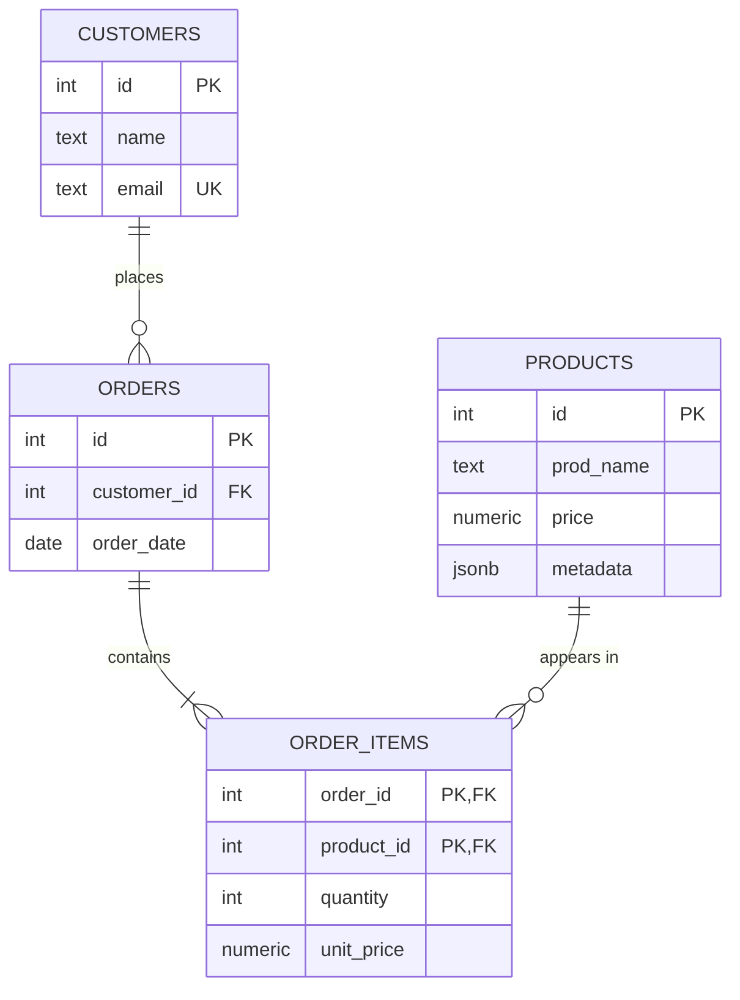

# E-Commerce Analytics Data Pipeline

A small backend for a fictional online store. It combines three databases, each used for what it does best:

| Store | Used for |
|---|---|
| **PostgreSQL** | Customers, products, orders, order items; product metadata as `JSONB`; analytical queries |
| **Redis** | Cache for the top 10 best-selling products (expires after 60 s) |
| **MongoDB** | Shopping-cart session documents |

Python 3.11+, `psycopg2` (with a connection pool), `redis`, `pymongo`, Poetry, Docker Compose.

## Entity-relationship diagram



## Schema and normalization decisions

The schema (`sql/schema.sql`) is in **third normal form (3NF)**.

- **Why four tables?** An order can contain many products, and a product can be in many orders. That many-to-many relationship needs a table in the middle: `order_items`. Putting products inside `orders` would repeat data and break 1NF.
- **Composite primary key `(order_id, product_id)`** in `order_items`: the same product can appear only once per order (increase `quantity` instead). `order_id` comes first, because that is how rows are looked up ("all items of order X"), so the primary-key index serves that query.
- **Why `unit_price` is stored in `order_items`.** It is a deliberate **price snapshot**: it records the price at the time of purchase. If a product's price changes later, old orders must keep what the customer actually paid. It is not a 3NF violation, because it is a historical fact about the order line, not a copy of the current price.
- **Every non-key column depends on the key, the whole key, and nothing but the key.** Customer details live only in `customers`, product details only in `products`, so each fact is stored once.
- **Constraints:** `NOT NULL` on required columns, `UNIQUE` on `customers.email`, `CHECK (price > 0)`, `CHECK (quantity > 0)`, and foreign keys from `orders` to `customers` and from `order_items` to `orders` and `products`.
- **Money is `NUMERIC(10,2)`**, never `FLOAT`: it stores exact decimals, so there are no rounding surprises. In Python it comes back as `Decimal`.
- **`products.metadata` is `JSONB`.** Different products have different attributes (colour, size, speed...), which would otherwise need many mostly-empty columns.

## Project structure

```
.
├── docker-compose.yml          # PostgreSQL, Redis, MongoDB
├── pyproject.toml / poetry.lock
├── requirements.txt
├── sql/
│   ├── schema.sql              # DDL + indexes
│   └── sample_data.sql         # sample rows
├── src/ecommerce_analytics_data_pipeline/
│   ├── db.py                   # connection pool
│   ├── store.py                # add_product, create_order, get_customer_orders
│   ├── analytics.py            # RANK() / CTE / JSONB queries, EXPLAIN helper
│   ├── cache.py                # Redis
│   ├── sessions.py             # MongoDB
│   └── main.py                 # end-to-end demo
└── tests/
    ├── conftest.py
    └── test_store.py
```

## How to run

You need Docker Desktop and Poetry.

```bash
# 1. Start the databases
docker compose up -d
docker compose ps            # wait until postgres is "healthy"

# 2. Load the schema and sample data (once)
docker cp sql/schema.sql ecom_postgres:/schema.sql
docker cp sql/sample_data.sql ecom_postgres:/sample_data.sql
docker exec -it ecom_postgres psql -U app -d ecommerce -f /schema.sql
docker exec -it ecom_postgres psql -U app -d ecommerce -f /sample_data.sql

# 3. Install Python dependencies
poetry install

# 4. Run the demo
poetry run python -m ecommerce_analytics_data_pipeline.main

# 5. Run the tests
poetry run pytest -v
```

**Note on the port:** PostgreSQL is published on host port **5433** (`5433:5432` in `docker-compose.yml`), because port 5432 was already in use on the development machine. The code defaults to 5433. To use another port, set the `PGPORT` environment variable.

Connection settings can be overridden with environment variables: `PGHOST`, `PGPORT`, `PGUSER`, `PGPASSWORD`, `PGDATABASE`, `REDIS_HOST`, `REDIS_PORT`, `MONGO_URI`.

To start again from scratch: `docker compose down -v`, then repeat steps 1 and 2 **once** (loading the sample data twice fails on the unique email).

## What the code does

### Python database access (`db.py`, `store.py`)
- A `SimpleConnectionPool` (1 to 5 connections). Functions borrow a connection with `get_connection()` and always give it back in a `finally` block.
- **All queries are parameterized** (`%s` placeholders with a tuple), so user input is never pasted into SQL (protection against SQL injection).
- `create_order(customer_id, items)` is **one transaction** (`with conn:`): it inserts the order, then for each item reads the product's current price and inserts the order line with that price as `unit_price`. If any step fails (for example an unknown product), the whole transaction rolls back and no order or item is saved.
- `add_product(...)` stores optional `JSONB` metadata. `get_customer_orders(...)` joins the three tables.

### Analytics (`analytics.py`)
- **`top_products()`**: `RANK() OVER (ORDER BY SUM(quantity) DESC)` ranks products by units sold (top 10). Ties share a rank.
- **`top_customers()`**: a **CTE** (`WITH customer_spend AS ...`) computes revenue per customer, then `RANK()` orders the results.
- **`products_with_metadata({...})`**: finds products with the `JSONB` containment operator `@>`.

### Redis (`cache.py`)
The top 10 best sellers are stored as JSON with a 60-second expiry (`ex=60`). Product rankings change slowly and are expensive to compute, so a short-lived cache avoids recomputing them on every request, and the expiry guarantees the data cannot stay stale for long.

### MongoDB (`sessions.py`)
Cart sessions are stored as documents (`customer_id`, `cart`, `created_at`). A cart is a nested, changing list of items that is read and written as a whole, which suits a document store better than several relational tables.

## Optimization report

The tool is `EXPLAIN ANALYZE`, which really executes the query and shows the plan and the timing.

### 1. B-tree index on `orders.customer_id`
```sql
CREATE INDEX idx_orders_customer_id ON orders(customer_id);
```
Query measured: `SELECT * FROM orders WHERE customer_id = <id>;` on a bulk-loaded test table (rollback afterwards, so the real data is untouched).

### 2. GIN index on `products.metadata`
```sql
CREATE INDEX idx_products_metadata ON products USING GIN (metadata);
```
A GIN index supports the `@>` (contains) operator on `JSONB`. A normal B-tree index does not help for this kind of search. On a very small table Postgres may still choose a sequential scan, because reading a few rows is cheaper than using an index; the benefit appears as the table grows.

## Testing

`tests/test_store.py` runs against the real PostgreSQL container and covers:
- `add_product` saves the row with its metadata.
- `create_order` saves the items with the price at the time of purchase.
- `create_order` rolls back when one item fails.

**Limits (honest notes):**
- The Redis, MongoDB and analytics functions were checked manually through `main.py` and not with automated tests.
- The rollback test accepts either a `ValueError` or a database error, so it checks that nothing was saved rather than a specific error type.

## Known issues / not done
- No automated tests for the cache, sessions and analytics modules.
- `main.py` creates a new order on every run (it is a demo).